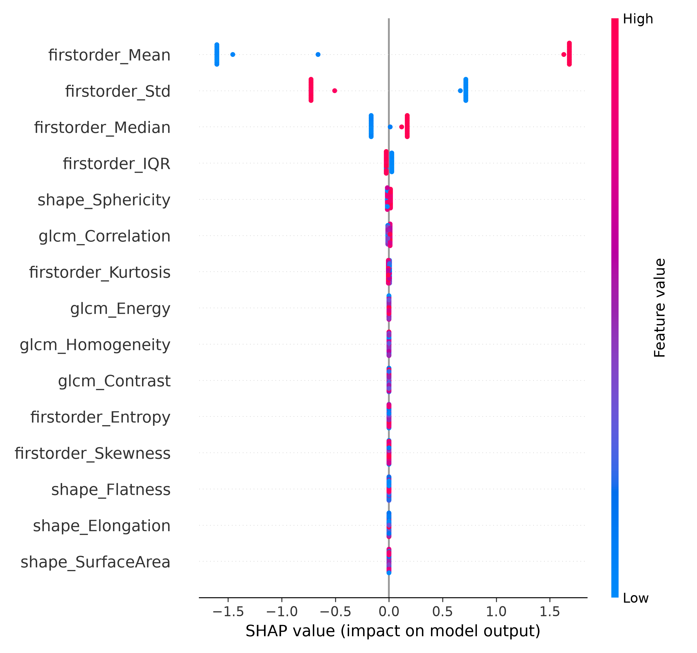

# Non-Invasive Molecular Phenotype Prediction in Gliomas via 3D MRI Radiomics & ML

Quantitative imaging and radiogenomics pipeline to predict molecular biomarkers in gliomas (such as IDH mutation and 1p/19q codeletion) from 3D MRI and tumor segmentation masks, with SHAP explainability.

## Quick Run

    python src/generate_demo_data.py
    python src/extract_radiomics.py
    python src/train_classifier.py

## Author
Izan Martínez Marín — MSc in Biomedical Biotechnology.
